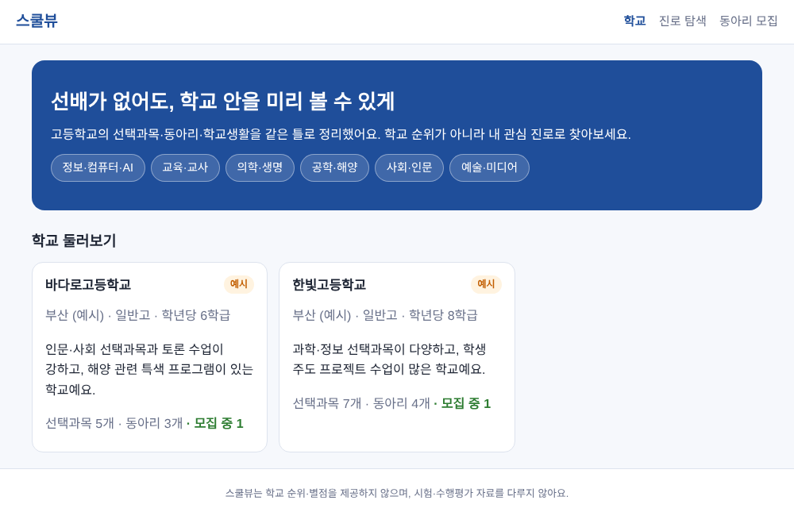
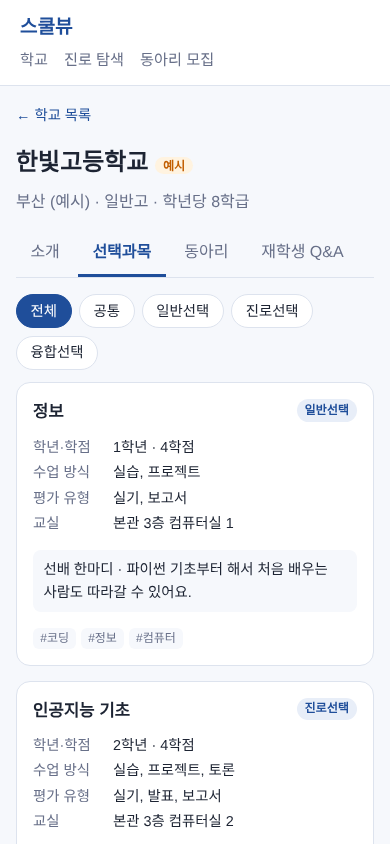
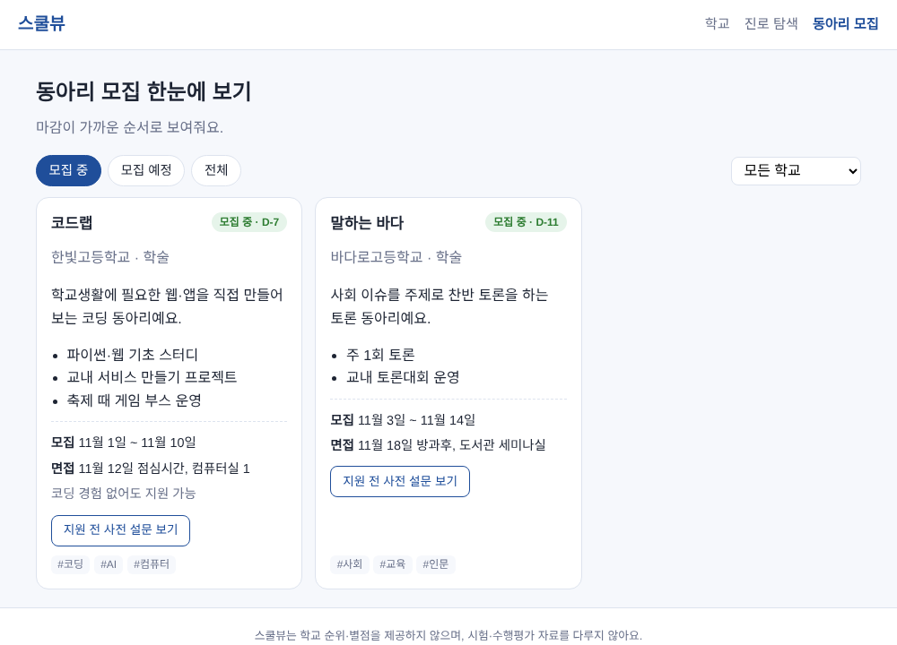
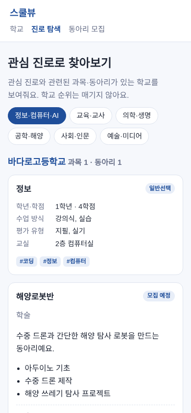

# 스쿨뷰 (SchoolView)

> 선배가 없어도, 학교 안을 미리 볼 수 있게

고등학교의 **선택과목·동아리·학교생활** 정보를 학교마다 같은 틀로 정리해 보여주는 웹 서비스입니다.
중학생은 고등학교 진학 전에 학교를 탐색하고, 고등학생은 입학 후 과목과 동아리를 고를 때 같은 정보를 활용합니다.

**🔗 바로 써보기: https://doranayoung.github.io/schoolview/** (휴대폰에서 열고 "홈 화면에 추가"하면 앱처럼 쓸 수 있어요)

> ⚠️ **현재 초안(1단계 MVP) 단계입니다.** 들어 있는 학교 정보는 화면 확인용 **가상 예시 데이터**이며 실제 학교와 관계없습니다.

<p>
  
  
</p>

## 왜 만들었나요?

- **동아리 정보가 흩어져 있어요.** 고등학교 동아리 모집은 반에 붙은 포스터나 SNS로만 알려지고, 동아리마다 모집 기간과 면접 일정이 달라 놓치기 쉽습니다.
- **고교학점제 이후 선택이 많아졌어요.** 과목 이름은 전국 공통이지만, 실제 수업 방식과 평가 유형, 개설 여부는 학교마다 다릅니다.
- **정보 격차가 있어요.** 공식 정보(학교알리미)는 읽고 비교하기 어렵고, 실제 학교생활 정보는 주변에 선배가 있어야 얻을 수 있습니다.

스쿨뷰는 이 정보를 한곳에 같은 형식으로 모아, 누구나 소문이 아닌 정보로 선택할 수 있게 하는 것을 목표로 합니다.

## 주요 기능

| 기능 | 설명 |
|---|---|
| 🏫 학교 소개 카드 | 학급 수, 특색 프로그램, 개설 과목·동아리 수를 같은 형식으로 정리 |
| 📚 선택과목 가이드 | 과목별 학년·학점, 수업 방식, 평가 유형, 교실 위치, 선배 한마디 |
| 📅 동아리 모집 모아보기 | 여러 학교 동아리의 모집 기간·면접 일정을 마감 순으로 정렬 (`모집 중 · D-7`) |
| 📝 사전 설문 작성·제출 | 동아리 사전 설문을 미리 써 두고, 모집이 열리면 동아리 신청서(구글 설문 등)로 제출. 답변이 신청서에 자동으로 채워지며, 스쿨뷰는 지원자 정보를 저장하지 않음 |
| 🧭 관심 진로로 찾아보기 | 관심 진로를 고르면 관련 과목·동아리가 있는 학교를 보여줌 (순위 없음) |
| 💬 재학생 Q&A | 재학생이 정해진 질문에 답변을 제출하고, 학생회·담당 교사가 검수한 답변만 공개 (답변자는 학년만 표시) |
| 🛠️ 학교 정보 입력 도우미 | 교사·학생회가 칸만 채우면 학교 JSON 파일을 만들어 줌. 빠진 내용·설계 원칙 위반 점검, 학생 화면 미리보기 |

<p>
  
  
</p>

## 설계 원칙

중·고등학생이 쓰는 서비스이기 때문에, 기능보다 안전과 공정성을 먼저 생각합니다.

1. **익명 자유 게시판을 두지 않습니다.** 정해진 질문과 검수 절차로 대신합니다.
2. **학교 순위·별점을 제공하지 않습니다.** '좋은 학교'가 아닌 '나에게 맞는 학교'를 찾도록 합니다.
3. **시험·수행평가 자료를 다루지 않습니다.**
4. **개인정보를 최소한으로 수집합니다.** 학생은 로그인 없이 쓰고, 재학생 답변에는 학년만 남습니다. 로그인은 검수자(학생회·교사)만 합니다.
5. **학교 정보는 학교(교사·학생회)의 확인을 거쳐 공개합니다.**

## 기술 스택

- React 19 + TypeScript + Vite
- React Router (HashRouter)
- vite-plugin-pwa — 홈 화면에 추가하면 앱처럼 실행
- 학교 정보: JSON 파일로 관리 (서버 없음)
- 재학생 Q&A: [Supabase](https://supabase.com) (선택 · 설정하지 않으면 이 기능만 꺼짐, [설정 안내](docs/supabase-setup.md))

## 시작하기

[Node.js](https://nodejs.org) 22 LTS 이상이 필요합니다 (Vite 8·TypeScript 7 때문에 20.19 미만에서는 빌드되지 않아요).

```bash
git clone https://github.com/doranayoung/schoolview.git
cd schoolview
npm install
npm run dev
```

브라우저에서 http://localhost:5173 을 열면 됩니다. 재학생 Q&A 작성·검수까지 쓰려면 `.env.example`을 `.env.local`로 복사해 Supabase 정보를 넣어 주세요.

| 명령어 | 설명 |
|---|---|
| `npm run dev` | 개발 서버 실행 |
| `npm run build` | 타입 검사 후 배포용 빌드 (`dist/`) |
| `npm run preview` | 빌드 결과 미리보기 |
| `npm run lint` | 코드 검사 |

## 배포

`main` 브랜치에 올리면 GitHub Actions([deploy.yml](.github/workflows/deploy.yml))가 린트·빌드한 뒤 GitHub Pages에 배포합니다. Pull Request는 린트·빌드만 확인합니다.

- 처음 한 번: 저장소 **Settings → Pages → Build and deployment → Source**를 **GitHub Actions**로 바꿉니다.
- 재학생 Q&A를 켜려면: **Settings → Secrets and variables → Actions → Variables**에 `VITE_SUPABASE_URL`, `VITE_SUPABASE_PUBLISHABLE_KEY`를 넣고 다시 배포합니다. ([설정 안내](docs/supabase-setup.md))

## 프로젝트 구조

```
schoolview/
├─ src/
│  ├─ data/
│  │  ├─ schools/      # 학교별 정보 JSON (학교 하나 = 파일 하나)
│  │  ├─ index.ts      # 데이터 불러오기, 진로 탐색 키워드
│  │  └─ options.ts    # 과목 구분·수업 방식·평가 유형 등 정해진 항목
│  ├─ pages/           # 학교 목록·상세, 진로 탐색, 동아리 모집, 입력 도우미
│  ├─ components/      # 공통 레이아웃, 과목·동아리 카드, 사전 설문, 입력 칸
│  ├─ lib/             # Supabase 연결, 재학생 Q&A 읽기·제출·검수
│  ├─ utils/           # 모집 상태·D-day, 신청서 링크, 학교 정보 검사·JSON 변환
│  └─ types.ts         # 학교·과목·동아리 데이터 형식
├─ supabase/schema.sql # 재학생 Q&A DB 스키마와 권한(RLS)
├─ .github/workflows/  # GitHub Pages 자동 배포
├─ public/             # 아이콘, 파비콘
└─ docs/               # 입력 가이드, Supabase 설정 안내, README용 화면 캡처
```

## 학교 추가하기

**교사·학생회는 [입력 가이드](docs/data-guide.md)를 따라 앱의 입력 도우미(화면 맨 아래 링크, `#/editor`)를 쓰면 됩니다.** 칸을 채우면 빠진 내용과 설계 원칙 위반을 점검해 주고, 올릴 JSON 파일을 만들어 줍니다.

직접 파일을 만들 수도 있습니다. `src/data/schools/` 폴더에 JSON 파일을 하나 추가하면 목록에 자동으로 나타납니다. 형식은 `src/types.ts`의 `School`을 따르며, 기존 예시 파일을 복사해서 고치는 게 가장 쉽습니다. 개발 서버(`npm run dev`)에서는 데이터에 문제가 있으면 브라우저 콘솔에 알려줍니다.

```json
{
  "id": "my-school",
  "name": "○○고등학교",
  "region": "부산",
  "type": "일반고",
  "classesPerGrade": 8,
  "intro": "한 줄 소개",
  "highlights": ["특징 1", "특징 2"],
  "subjects": [],
  "clubs": [],
  "qna": [],
  "updatedAt": "2026-11-03",
  "sources": ["학교알리미", "학교 제공"]
}
```

### 동아리 신청서 연결하기

동아리에 `applyForm`을 넣으면 학생이 스쿨뷰에서 쓴 사전 설문 답변을 그 신청서로 바로 제출할 수 있습니다. 지원자의 이름·학번 같은 정보는 스쿨뷰가 아니라 동아리·학교가 운영하는 신청서에만 남습니다.

1. 구글 설문에 사전 설문 문항(`survey`)을 **같은 순서로** 만들고, 학번·이름 문항은 그 뒤에 둡니다.
2. 구글 설문 편집 화면 ⋮ 메뉴 → **미리 채워진 링크 가져오기**에서 각 문항에 아무 값(예: 1, 2, 3)이나 넣고 링크를 복사합니다.
3. 링크에 있는 `entry.숫자`를 문항 순서대로 적습니다.

```json
"survey": ["만들어 보고 싶은 것은?", "코딩 경험이 있나요?"],
"applyForm": {
  "url": "https://docs.google.com/forms/d/e/.../viewform",
  "entries": ["entry.1234567", "entry.7654321"]
}
```

`entries` 없이 `url`만 넣어도 됩니다. 이때는 신청서를 열면서 답변이 클립보드에 복사돼, 학생이 붙여넣기만 하면 됩니다.

## 로드맵

- [x] 1단계 MVP: 학교 카드, 선택과목 가이드, 동아리 모집 모아보기, 진로 탐색
- [x] 동아리 사전 설문 작성 후 동아리 신청서로 제출 (구글 설문 자동 채우기)
- [x] 교사·학생회용 학교 정보 입력 도우미와 [입력 가이드](docs/data-guide.md)
- [ ] 모교 실제 데이터 입력 후 시범 운영 (2027년 3월 동아리 모집 시즌 목표)
- [x] 재학생 Q&A 작성·검수 기능 (Supabase, [설정 안내](docs/supabase-setup.md))
- [x] 웹 배포 (GitHub Pages, main에 올리면 자동 배포)

## 만든 사람

**Erica** · 국립부경대학교 컴퓨터·인공지능공학부
