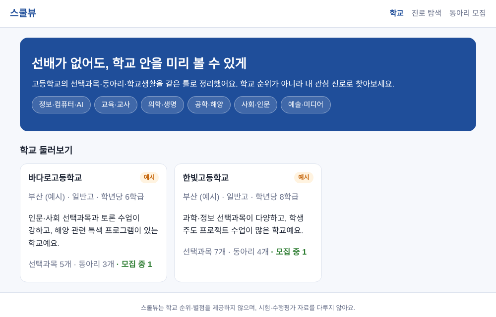
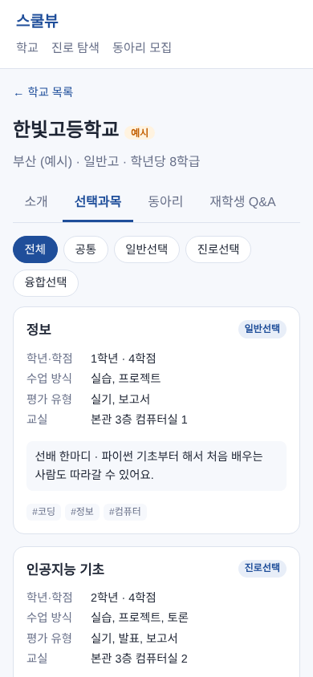
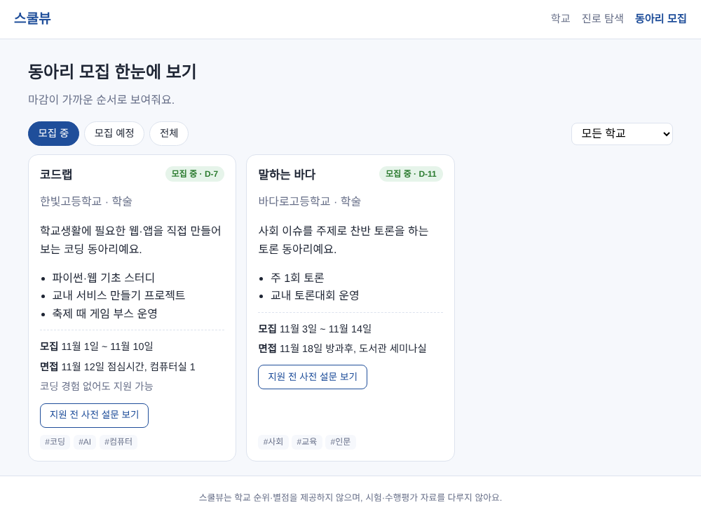
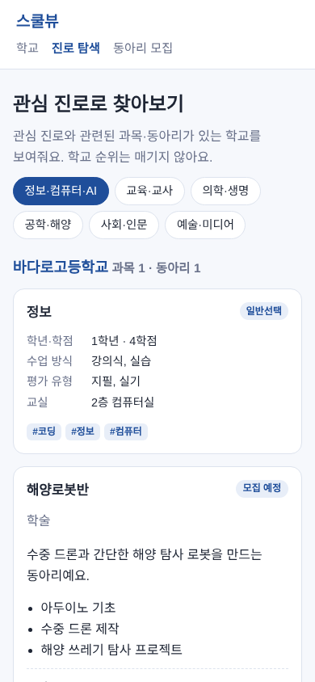

# 스쿨뷰 (SchoolView)

> 선배가 없어도, 학교 안을 미리 볼 수 있게

고등학교의 **선택과목·동아리·학교생활** 정보를 학교마다 같은 틀로 정리해 보여주는 웹 서비스입니다.
중학생은 고등학교 진학 전에 학교를 탐색하고, 고등학생은 입학 후 과목과 동아리를 고를 때 같은 정보를 활용합니다.

> ⚠️ **현재 초안(1단계 MVP) 단계입니다.** 들어 있는 학교 정보는 화면 확인용 **가상 예시 데이터**이며 실제 학교와 관계없습니다.

<p>
  
  
</p>

## 왜 만들었나요?

- **동아리 정보가 흩어져 있어요.** 고등학교 동아리 모집은 반에 붙은 포스터나 SNS로만 알려지고, 동아리마다 모집 기간과 면접 일정이 달라 놓치기 쉽습니다.
- **고교학점제 이후 선택이 많아졌어요.** 과목 이름은 전국 공통이지만, 실제 수업 방식과 평가 유형, 개설 여부는 학교마다 다릅니다.
- **정보 격차가 있어요.** 공식 정보(학교알리미)는 읽고 비교하기 어렵고, 실제 학교생활 정보는 주변에 선배가 있어야 얻을 수 있습니다.

스쿨뷰는 이 정보를 한곳에 같은 형식으로 모아, 누구나 소문이 아닌 정보로 선택할 수 있게 하는 것을 목표로 합니다.

## 주요 기능

| 기능 | 설명 |
|---|---|
| 🏫 학교 소개 카드 | 학급 수, 특색 프로그램, 개설 과목·동아리 수를 같은 형식으로 정리 |
| 📚 선택과목 가이드 | 과목별 학년·학점, 수업 방식, 평가 유형, 교실 위치, 선배 한마디 |
| 📅 동아리 모집 모아보기 | 여러 학교 동아리의 모집 기간·면접 일정을 마감 순으로 정렬 (`모집 중 · D-7`), 지원 전 사전 설문 미리보기 |
| 🧭 관심 진로로 찾아보기 | 관심 진로를 고르면 관련 과목·동아리가 있는 학교를 보여줌 (순위 없음) |
| 💬 재학생 Q&A | 정해진 질문에 대한 재학생 답변을 학생회·교사 확인 후 공개 |

<p>
  
  
</p>

## 설계 원칙

중·고등학생이 쓰는 서비스이기 때문에, 기능보다 안전과 공정성을 먼저 생각합니다.

1. **익명 자유 게시판을 두지 않습니다.** 정해진 질문과 검수 절차로 대신합니다.
2. **학교 순위·별점을 제공하지 않습니다.** '좋은 학교'가 아닌 '나에게 맞는 학교'를 찾도록 합니다.
3. **시험·수행평가 자료를 다루지 않습니다.**
4. **개인정보를 최소한으로 수집합니다.** 현재 단계는 로그인 없이 동작합니다.
5. **학교 정보는 학교(교사·학생회)의 확인을 거쳐 공개합니다.**

## 기술 스택

- React 19 + TypeScript + Vite
- React Router (HashRouter)
- vite-plugin-pwa — 홈 화면에 추가하면 앱처럼 실행
- 백엔드 없음 (1단계): 학교 데이터는 JSON 파일로 관리

## 시작하기

[Node.js](https://nodejs.org) LTS 버전이 필요합니다.

```bash
git clone https://github.com/<your-id>/schoolview.git
cd schoolview
npm install
npm run dev
```

브라우저에서 http://localhost:5173 을 열면 됩니다.

| 명령어 | 설명 |
|---|---|
| `npm run dev` | 개발 서버 실행 |
| `npm run build` | 타입 검사 후 배포용 빌드 (`dist/`) |
| `npm run preview` | 빌드 결과 미리보기 |
| `npm run lint` | 코드 검사 |

## 프로젝트 구조

```
schoolview/
├─ src/
│  ├─ data/
│  │  ├─ schools/      # 학교별 정보 JSON (학교 하나 = 파일 하나)
│  │  └─ index.ts      # 데이터 불러오기, 진로 탐색 키워드
│  ├─ pages/           # 학교 목록, 학교 상세, 진로 탐색, 동아리 모집 화면
│  ├─ components/      # 공통 레이아웃, 과목·동아리 카드
│  ├─ utils/recruit.ts # 동아리 모집 상태·D-day 계산
│  └─ types.ts         # 학교·과목·동아리 데이터 형식
├─ public/             # 아이콘, 파비콘
└─ docs/screenshots/   # README용 화면 캡처
```

## 학교 추가하기

`src/data/schools/` 폴더에 JSON 파일을 하나 추가하면 목록에 자동으로 나타납니다. 형식은 `src/types.ts`의 `School`을 따르며, 기존 예시 파일을 복사해서 고치는 게 가장 쉽습니다.

```json
{
  "id": "my-school",
  "name": "○○고등학교",
  "region": "부산",
  "type": "일반고",
  "classesPerGrade": 8,
  "intro": "한 줄 소개",
  "highlights": ["특징 1", "특징 2"],
  "subjects": [],
  "clubs": [],
  "qna": [],
  "updatedAt": "2026-11-03",
  "sources": ["학교알리미", "학교 제공"]
}
```

## 로드맵

- [x] 1단계 MVP: 학교 카드, 선택과목 가이드, 동아리 모집 모아보기, 진로 탐색
- [ ] 동아리 사전 설문 실제 제출 기능
- [ ] 교사·학생회용 학교 정보 입력 화면
- [ ] 모교 실제 데이터 입력 후 시범 운영 (2027년 3월 동아리 모집 시즌 목표)
- [ ] 재학생 Q&A 작성·검수 기능
- [ ] 웹 배포 (GitHub Pages 또는 Vercel)

## 만든 사람

**Erica** · 국립부경대학교 컴퓨터·인공지능공학부
